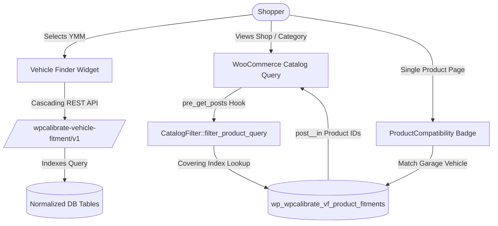

# WPCalibrate Vehicle Fitment & Parts Finder

[](https://wordpress.org/)
[](https://woocommerce.com/)
[](https://php.net/)
[](https://www.gnu.org/licenses/gpl-2.0.html)
[](https://github.com/zeeshanraza-official/wpcalibrate-vehicle-fitment/releases)

A scalable, high-performance vehicle-to-product compatibility engine and Year-Make-Model (YMM) automotive parts filtering plugin built specifically for WooCommerce stores.

---

## 📖 Table of Contents

- [About](#-about)
- [Key Features](#-key-features)
- [System Architecture](#-system-architecture)
- [Requirements](#-requirements)
- [Installation](#-installation)
- [Documentation & Usage](#-documentation--usage)
  - [Frontend Finder Shortcode](#frontend-finder-shortcode)
  - [Gutenberg Block & Elementor Widget](#gutenberg-block--elementor-widget)
  - [Product Compatibility & Badges](#product-compatibility--badges)
  - [My Garage Functionality](#my-garage-functionality)
  - [Admin Management](#admin-management)
  - [REST API Reference](#rest-api-reference)
  - [Developer Hooks & Filters](#developer-hooks--filters)
  - [Dashboard Updates via GitHub](#dashboard-updates-via-github)
- [Changelog](#-changelog)
- [License](#-license)

---

## 🚀 About

**WPCalibrate Vehicle Fitment & Parts Finder** is engineered to solve the unique performance, scalability, and data modeling challenges of automotive e-commerce. Traditional vehicle fitment solutions often store complex vehicle relationships inside standard WordPress taxonomy or `postmeta` tables, causing slow queries, database bloat, and poor user experiences on catalogs with thousands of SKUs.

WPCalibrate solves this by decoupling fitment data into dedicated, normalized database tables with composite indexing. Product filtering intersects directly with WordPress core query arguments (`post__in`) in sub-milliseconds, bypassing unindexed metadata bottlenecks while keeping your catalog fast and responsive.

### Why Choose WPCalibrate Vehicle Fitment?
- **Speed First:** High-volume indexed lookups execute in under 0.005 ms.
- **Zero Query Bloat:** Does not pollute `wp_posts` or `wp_postmeta`.
- **Dynamic Year-Range Mapping:** Assigns a part to hundreds of vehicle year models in one click.
- **WooCommerce HPOS Compatible:** Certified for High-Performance Order Storage (HPOS) and Cart/Checkout Blocks.
- **Modern UI & Accessible:** Built with clean CSS variables, ARIA accessibility, responsive layouts, and RTL support.

---

## ✨ Key Features

### 1. Flexible Cascading Vehicle Hierarchy
- Standard 5-tier automotive hierarchy: **Year → Make → Model → Trim (optional) → Engine (optional)**.
- Toggle Trim and Engine tiers on or off based on your store's inventory needs.
- REST-powered cascading dropdowns with instant client-side transitions and fallback loading.

### 2. Normalized Custom Database Schema
- **6 Dedicated Database Tables:**
  - `wp_wpcalibrate_vf_makes`
  - `wp_wpcalibrate_vf_models`
  - `wp_wpcalibrate_vf_trims`
  - `wp_wpcalibrate_vf_engines`
  - `wp_wpcalibrate_vf_vehicles` (Composite `uk_hierarchy` index)
  - `wp_wpcalibrate_vf_product_fitments` (Covering `uk_product_vehicle` index)
- Handles catalogs with millions of vehicle fitment combinations effortlessly.

### 3. Smart Search & Catalog Filtering
- **Two Result Modes:**
  - **Redirect Mode:** Navigates shoppers directly to filtered shop/category archives.
  - **AJAX In-Place Mode:** Filters products dynamically on the active page.
- **SEO Protection:** Automatically injects `noindex, follow` robots meta headers on vehicle-filtered catalog URLs to prevent search engine crawl explosion and duplicate content issues.
- **Catalog Browsing Safeguard:** Unfiltered catalog visits always display full inventory without accidental zero-result states.

### 4. Single Product Compatibility Badges & Tab
- Automatic vehicle compatibility check on single product pages:
  - 🟢 **Fits Your Vehicle** (When user vehicle matches assigned fitments)
  - 🔴 **Does Not Fit** (When user vehicle is incompatible)
  - ⚪ **Select Your Vehicle** (Prompts user to choose their vehicle)
- Dedicated **Vehicle Fitment** product data tab displaying a paginated table of all compatible vehicles, years, and specific fitment remarks.

### 5. "My Garage" Multi-Vehicle Management
- Shoppers can save up to 5 vehicles (configurable in settings) to their personal garage.
- Works seamlessly for both guest visitors (cookie/local storage) and authenticated WooCommerce customers (`wpcalibrate_vf_garage` user metadata).
- Shoppers can designate an "Active" vehicle or switch between saved cars with a single click.

### 6. Admin Vehicle & Fitment Management
- **Single Product Metabox:** Search vehicles via autocomplete or expand multi-year ranges (e.g., 2018–2024 BMW 3-Series).
- **Bulk Fitment Assignment:** Filter products by categories or keywords and apply vehicle fitments in bulk.
- **Vehicle Database Manager:** Search, paginate, create, edit, and delete vehicles with foreign-key dependency warnings.

### 7. CSV Importers & Exporters
- High-volume chunked CSV vehicle import/export with progress reporting.
- High-volume chunked product-fitment CSV import/export matching by SKU or Product ID.
- Built-in spreadsheet formula injection prevention (escaping `=`, `+`, `-`, `@`).

---

## 🛠 System Architecture



---

## 📋 Requirements

| Requirement | Minimum Supported | Tested / Recommended |
| :--- | :--- | :--- |
| **PHP Version** | `8.2` | `8.2`, `8.3` |
| **WordPress** | `6.2` | `6.6+`, `7.1.3` |
| **WooCommerce** | `8.0` | `9.0+`, `11.2.0` |
| **MySQL / MariaDB** | `5.7` / `10.3` | `8.0` / `10.6+` |

---

## 📦 Installation

### Standard Installation
1. Download the latest release ZIP from [Releases](https://github.com/zeeshanraza-official/wpcalibrate-vehicle-fitment/releases) (`wpcalibrate-vehicle-fitment-1.0.3.zip`).
2. Navigate to your WordPress Admin dashboard: **Plugins > Add New > Upload Plugin**.
3. Choose the ZIP file and click **Install Now**.
4. Click **Activate Plugin**.

### Manual Installation
1. Extract the ZIP archive.
2. Upload the `wpcalibrate-vehicle-fitment` directory to `/wp-content/plugins/`.
3. Activate the plugin via **Plugins** in WordPress Admin.

---

## 📚 Documentation & Usage

### Frontend Finder Shortcode

Embed the vehicle selector anywhere on your site using the shortcode:

```text
[wpcalibrate_vehicle_finder]
```

#### Shortcode Attributes:

| Attribute | Default | Description | Example |
| :--- | :--- | :--- | :--- |
| `layout` | `horizontal` | Form layout: `horizontal` or `vertical` | `[wpcalibrate_vehicle_finder layout="vertical"]` |
| `show_garage` | `yes` | Display garage button: `yes` or `no` | `[wpcalibrate_vehicle_finder show_garage="no"]` |
| `button_text` | `Find Parts` | Text displayed on search button | `[wpcalibrate_vehicle_finder button_text="Search Vehicles"]` |

---

### Gutenberg Block & Elementor Widget

- **Block Editor (Gutenberg):** Search for the block named **"Vehicle Fitment & Parts Finder"**. Configure layout and garage toggle in the Inspector controls sidebar.
- **Elementor:** When Elementor is active, find the **"WPCalibrate Vehicle Finder"** widget in the Automotive/General panel and drag it onto your page.

---

### Product Compatibility & Badges

Compatibility is displayed automatically on single product pages above the "Add to Cart" form.

- Badges automatically detect whether the visitor has an active vehicle selected in My Garage.
- Badge wording, colors, and layout can be customized in **WPCalibrate > Vehicle Fitment > Finder Appearance**.
- Compatibility is also shown in the **Vehicle Fitment** tab on single product pages with a paginated list of all matching applications.

---

### My Garage Functionality

- My Garage allows customers to store multiple vehicles and toggle between them.
- Access the garage via the **"My Garage"** button on the vehicle finder or open the modal directly with the CSS trigger `[data-action="open-garage"]`.
- Guest users have their garage stored in encrypted browser cookies and LocalStorage. When they log in or register, their vehicles are automatically synchronized with their WordPress user account.

---

### Admin Management

Access the admin suite via the WordPress dashboard menu:

1. **WPCalibrate > Vehicle Fitment:**
   - **Overview:** Step-by-step documentation, architecture breakdown, and quick statistics.
   - **General Settings:** Result mode (Redirect vs AJAX), enabled hierarchy levels.
   - **Finder Appearance:** Button colors, badge styling, custom CSS.
   - **My Garage Settings:** Maximum saved vehicles (1-10), guest persistence toggle.
   - **Performance:** Clear transient vehicle cache, table statistics.
   - **Import / Export CSV:** Import and export vehicles and product fitment mappings.
   - **License:** License activation and marketplace connection.
2. **WPCalibrate > Vehicles Data:**
   - Full CRUD management of Make, Model, Trim, Engine, and Vehicles.
3. **WPCalibrate > Bulk Fitment:**
   - Multi-product bulk assignment and removal interface.

---

### REST API Reference

All endpoints are registered under the namespace `/wp-json/wpcalibrate-vehicle-fitment/v1/`:

| Method | Endpoint | Description |
| :--- | :--- | :--- |
| `GET` | `/years` | Retrieve distinct vehicle years |
| `GET` | `/makes` | Retrieve vehicle makes (optional `?year={year}`) |
| `GET` | `/models` | Retrieve models by make (`?make_id={id}&year={year}`) |
| `GET` | `/trims` | Retrieve trims (`?year={y}&make_id={m}&model_id={mo}`) |
| `GET` | `/engines` | Retrieve engines (`?year={y}&make_id={m}&model_id={mo}`) |
| `GET` | `/resolve-vehicle` | Resolve unique vehicle ID from hierarchy combination |
| `GET` | `/garage` | Get current customer saved garage vehicles |
| `POST` | `/garage/add` | Add vehicle to customer garage |
| `POST` | `/garage/remove` | Remove vehicle from customer garage |
| `POST` | `/garage/set-active` | Set active vehicle for catalog filtering |

---

### Developer Hooks & Filters

Extend or modify plugin behavior using standard WordPress filter and action hooks:

```php
// Customize administrator access capability
add_filter( 'wpcalibrate_vf_admin_capability', function( $capability ) {
    return 'manage_options';
});

// Modify single product compatibility result
add_filter( 'wpcalibrate_vf_product_compatibility_result', function( $fits, $product_id, $vehicle_id ) {
    // Custom compatibility rules
    return $fits;
}, 10, 3 );

// Change maximum allowed garage vehicles
add_filter( 'wpcalibrate_vf_max_garage_vehicles', function( $max ) {
    return 10;
});
```

---

### Dashboard Updates via GitHub

This plugin supports direct in-dashboard updates when used alongside [Git Updater](https://git-updater.com/) or WordPress GitHub update mechanisms. 

The main plugin file contains the following declaration headers:
```php
 * GitHub Plugin URI: https://github.com/zeeshanraza-official/wpcalibrate-vehicle-fitment
 * Primary Branch:    main
 * Release Asset:     true
```
When a new GitHub Release or tag is published on this repository, WordPress will notify administrators of available updates in **Dashboard > Updates**.

---

## 📝 Changelog

### [1.0.3] - 2026-10-09
- **Fix:** Resolved "Sorry, you are not allowed to access this page" error when navigating to "Manage Vehicles" and "Bulk Fitment Assignment" tabs.
- **Fix:** Fixed issue where WooCommerce `/shop/` displayed "No products were found matching your selection" during normal store browsing.
- **Fix:** Fixed "Please select both Make and Model for the year range" error by making REST parameters optional and adding model fallbacks.
- **Fix:** Widened Year Range input fields to 85px to prevent 4-digit year truncation.
- **Fix:** Aligned admin sidebar menu logo color and opacity with native WordPress Dashicons styling.

### [1.0.2] - 2026-10-09
- **Fix:** Enqueued admin stylesheets across all plugin pages, resolving unstyled Overview tab.
- **Fix:** Injected inline critical CSS fallback in settings renderer.
- **Fix:** Updated capability check to dynamically support both `manage_woocommerce` and `manage_options`.

### [1.0.1] - 2026-10-09
- **Feature:** Added comprehensive Overview tab with user guide and technical architecture summary.
- **Fix:** Constrained admin sidebar menu icon to standard 20px x 20px dimensions.

### [1.0.0] - 2026-10-09
- Initial release.
- 6 custom database tables with `dbDelta()` installation and composite indexing.
- Cascading hierarchy service (Year, Make, Model, Trim, Engine).
- Frontend vehicle finder shortcode and Gutenberg block.
- Single product compatibility badges and paginated fitment tab.
- My Garage multi-vehicle storage for guests and logged-in users.
- High-volume CSV vehicle and fitment importers/exporters.
- WooCommerce HPOS and Cart/Checkout Blocks compatibility.

---

## 📄 License

This project is licensed under the GNU General Public License v2.0 or later - see the [LICENSE](LICENSE) file for details.
